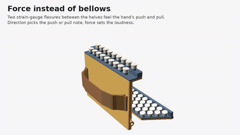
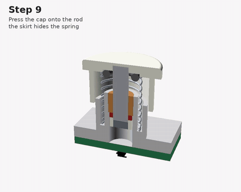

# Eziach

A Steirische Harmonika (diatonic button accordion) without bellows, in two halves. A
**discant** (46 keys, right hand) and a **bass** (2 × 9 keys, left hand) plug together
through two load cells: the push and pull of the hands between the halves is measured
as force, **instead of bellows**. Every key is a Hall-effect key, read continuously, so
the firmware sets its own trigger points. The ESP32-S3 in the bass makes the sound
(earphone jack) and speaks MIDI over USB-C. For carrying, the discant turns over and
plugs onto the bass, keys inside.

Everything here is parametric source: OpenSCAD for the printed parts and the
assemblies, Python generating the KiCad boards.

## Videos

**The instrument:** force instead of bellows, the keys, playing, inside, plugging the
halves together and packing away (1 min). Click the preview for the full video.

[](docs/media/eziach_promo.mp4)

**One key:** its parts, the assembly step by step, and the key pressed in section (1 min).

[](docs/media/key_assembly.mp4)

## Projects

| Folder | What |
|---|---|
| [`switch_hall/`](switch_hall/spec.md) | the key: a ground rod in a bronze bushing, magnet underneath, stock spring, O-ring stop; one source for discant and bass |
| [`discant/`](discant/spec.md) | right hand: one Hall board under 46 keys in four climbing rows, the tray housing, the cover with the thumb bar, the gauges' mount |
| [`bass/`](bass/spec.md) | left hand: 2 × 9 keys, hand plate and strap, battery, main board, the socket for the stored discant |
| [`assembly/`](assembly/spec.md) | both halves together, played and stored; the promo video |
| [`strain_gauge/`](strain_gauge/spec.md) | the load cells and their holders, the force path between the halves |
| [`hall_pcb/`](hall_pcb/spec.md) | the two key boards (DRV5055 per key, ADS7128 ADCs, NAU7802 for the gauges) |
| [`main_pcb/`](main_pcb/spec.md) | the main board: ESP32-S3, audio DAC, charger, 3.3 V supply |
| [`firmware/`](firmware/spec.md) | the ESP32-S3's firmware (ESP-IDF): Hall keys, load cells, the tuning table from the first eziach, TinySoundFont on the recorded Steirische to the earphone jack, USB-MIDI |
| [`contact_pcb/`](contact_pcb/spec.md) | spring-pin contacts that join power and I²C as the halves slide together |
| [`key_proto/`](key_proto/spec.md) | a test print: 2 rows of 4 keys on a board stand-in in the discant's tray, with the plate for a Bambu Lab X2D |
| [`thumb-bar/`](thumb-bar/profile.scad) | the discant's thumb bar profile |
| [`BOM.md`](BOM.md) | everything to buy, print or make for one instrument |
| [`TODO.md`](TODO.md) | open items |

## Building

```sh
make                    # switch_hall, discant, strain_gauge and key_proto into build/
make -C bass            # the bass and its phone page
make -C assembly        # both halves together, build/assembly/phone.html
make -C key_proto       # the 8-key test print, build/key_proto/plate.3mf
make -C firmware/test   # the firmware's host tests (the firmware itself: idf.py build in firmware/)
make -C switch_hall video   # the key video (about half an hour)
make -C assembly promo      # the promo video (about an hour)
```

Needs OpenSCAD and Python 3; the boards need KiCad, the videos GStreamer. Everything
generated goes to `build/`, which is not under version control. Each `phone.html` is a
single file with every part embedded, a 3D view for the phone.
